**Scope.** This report covers:

- capturing the September 2026 records (Section 1);
- building PostgreSQL (Section 2) and Neo4j (Section 3);
- the routine business questions Q1 to Q3 (Section 4);
- the connected-account investigations Q4 to Q7 (Section 5);
- correctness and performance (Section 6);
- concurrent requests (Section 7).

Each screenshot shows the executed command, its result, and the macOS menu-bar clock and Dock. Full outputs,
raw timing runs and plans are in `outputs/` in the code submission.

```{=openxml}
<w:p><w:r><w:br w:type="page"/></w:r></w:p>
```

# 1 Capture the data

## 1.1 Prepare your workspace

| Item | Value |
|---|---|
| CPU | Apple M2, 8 cores |
| RAM | 8.6 GB (8 GiB) |
| OS | macOS 14.6.1 (arm64) |
| PostgreSQL | 16.8 (Postgres.app), project database `momo`, `TimeZone = Africa/Kigali` (`ALTER DATABASE momo SET timezone`) |
| PostgreSQL memory | shared_buffers 128MB, work_mem 4MB, maintenance_work_mem 64MB (512MB in the index-build session), effective_cache_size 4GB |
| Neo4j | 5.26.0 Community, dedicated instance, default `neo4j` database, Java 17 |
| Neo4j memory | heap initial/max 2 GiB, page cache 2 GiB |
| Python and drivers | Python 3.13.2, psycopg 3.3.6, neo4j driver 6.4.1, numpy 2.5.4, matplotlib 3.11.2 |
| Generator | unchanged, sha256 `2ea0e59d…e9455a` |

{width=16cm}

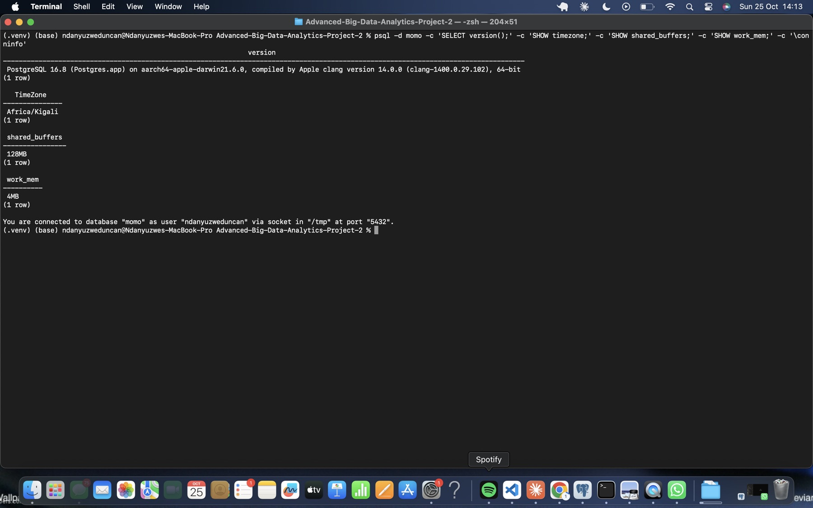{width=16cm}

{width=16cm}

## 1.2 Build capture.py

`capture.py` imports the generator as `g`, prints `g.dataset_info()` and `g.FIELDS`, and previews ten records
per stream with `itertools.islice`. Because each `iter_<stream>()` call creates a fresh generator, previewing
doesn't consume rows from the capture. Rows are written one at a time with `csv.DictWriter`, so no stream is
held in memory. The script logs every million transfers and keeps running audit totals. Earliest and latest
times are tracked with explicit min/max checks, because transfers aren't time-sorted.

| Stream | Consumed | Written | Expected | Match | Seconds | CSV MB |
|---|---:|---:|---:|---|---:|---:|
| customers | 228,000 | 228,000 | 228,000 | yes | 0.4 | 3.6 |
| accounts | 248,000 | 248,000 | 248,000 | yes | 0.5 | 5.2 |
| devices | 228,600 | 228,600 | 228,600 | yes | 0.3 | 3.6 |
| account_devices | 285,600 | 285,600 | 285,600 | yes | 0.7 | 6.3 |
| transfers | 20,003,300 | 20,003,300 | 20,003,300 | yes | 70.6 | 780.2 |
| **Total** | **20,993,500** | **20,993,500** | **20,993,500** | **yes** | **72.4** | **798.8** |

**Transfer audit:**

| Audit item | Value |
|---|---|
| Transfer count | 20,003,300 |
| Earliest `occurred_at` | 1788235200 (2026-09-01 06:00:00 CAT) |
| Latest `occurred_at` | 1790798399 (2026-09-30 21:59:59 CAT) |
| Sum of `amount_rwf` | 231,482,327,870 RWF |

{width=16cm}

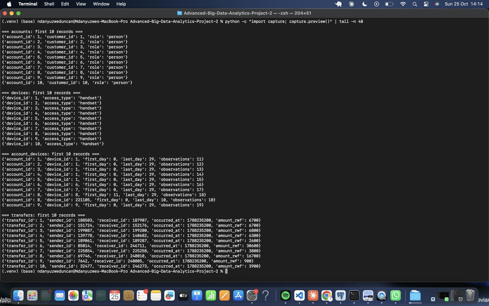{width=16cm}

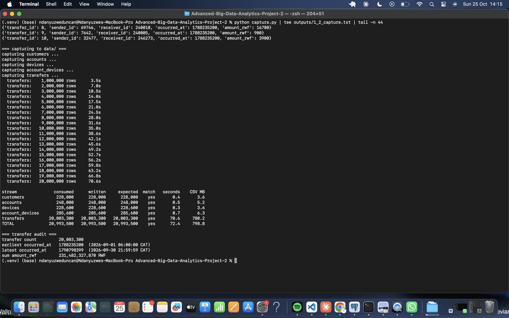{width=16cm}

# 2 Build PostgreSQL

## 2.1 Define the five tables

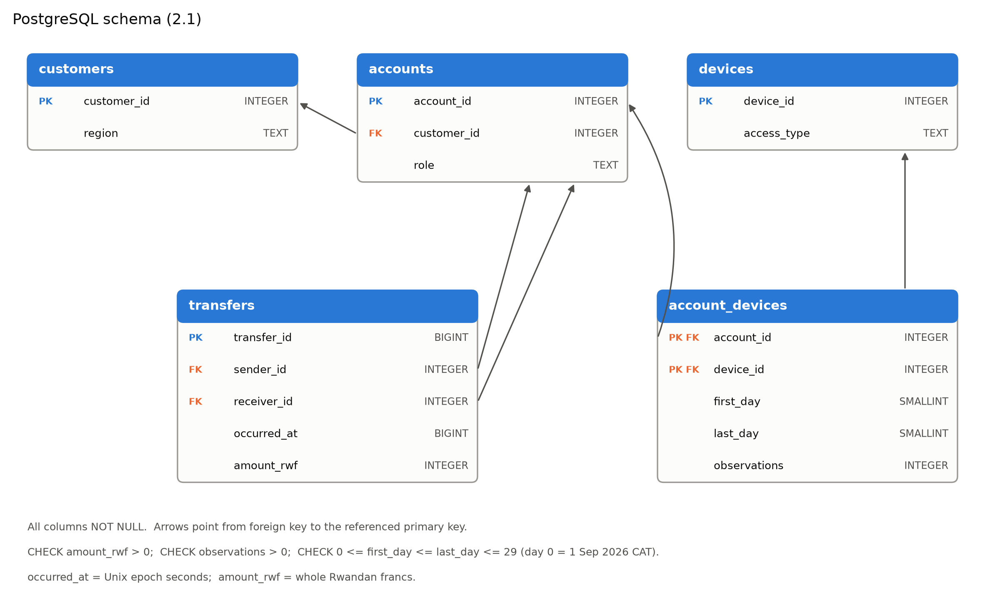{width=16cm}

| Table.field | Meaning and unit |
|---|---|
| customers.customer_id / region | Customer identifier; Kigali, Northern, Southern, Eastern or Western |
| accounts.account_id / customer_id / role | Wallet; owning customer (FK, ownership); `person`, `merchant` or `agent` |
| devices.device_id / access_type | Device identifier; `handset` or `public_terminal` |
| account_devices.first_day / last_day | Inclusive observation interval, as day numbers 0 to 29 (day 0 = 1 Sep 2026 CAT) |
| account_devices.observations | Number of observations of the wallet on the device within the interval. This is observed use, not ownership. |
| transfers.transfer_id | Event identifier (BIGINT) |
| transfers.sender_id / receiver_id | Paying and receiving wallets (FKs, both endpoints) |
| transfers.occurred_at | Unix epoch seconds (BIGINT); CAT = UTC+2 |
| transfers.amount_rwf | Positive whole Rwandan francs |

**Constraints:**

- Every column is `NOT NULL`.
- Primary keys are the entity and event IDs, plus `(account_id, device_id)` for `account_devices`.
- Five foreign keys cover ownership, device use (account and device), and both transfer endpoints.
- `CHECK` constraints: `amount_rwf > 0`, `observations > 0`, and `0 <= first_day <= last_day <= 29`.

{width=16cm}

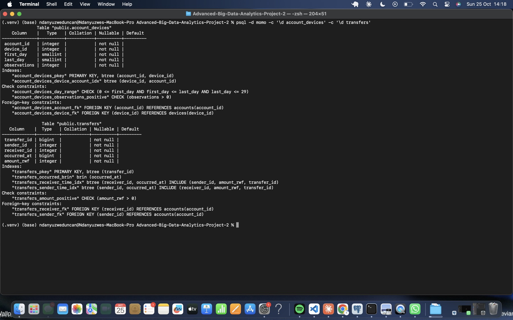{width=16cm}

## 2.2 Bulk-load and check

Tables were loaded parents first (customers, devices, accounts, account_devices, transfers) with `\copy … CSV HEADER`.
Keys and indexes were added after the load, so that each index is built once and its setup time is measured separately.

| Step | Seconds |
|---|---:|
| Load customers / devices / accounts / account_devices | 0.134 / 0.117 / 0.164 / 0.195 |
| Load transfers | 18.961 |
| **Total loading** | **19.57** |
| Primary keys (transfers: 28.51) | 29.23 |
| Foreign keys (two transfer FKs: 3.44 + 3.42) | 7.11 |
| Secondary indexes (covering transfer indexes 27.83 + 30.24, BRIN 2.57) | 60.84 |
| ANALYZE | 1.08 |
| **Total index/constraint setup** | **98.25** |

**Indexes:**

- `accounts(customer_id, account_id)`
- `account_devices(device_id, account_id)`
- `transfers(sender_id, occurred_at) INCLUDE (receiver_id, amount_rwf, transfer_id)`
- `transfers(receiver_id, occurred_at) INCLUDE (sender_id, amount_rwf, transfer_id)`
- BRIN on `occurred_at`

**Checks.** All row counts match capture.py (20,993,500 in total). Roles are 240,000 person, 6,000 merchant and
2,000 agent. The transfer audit is identical to capture.py. All 13 constraints show `convalidated = t`.

| Size (1 GB = 10⁹ bytes) | Data GB | Index GB | Total GB |
|---|---:|---:|---:|
| transfers | 1.206 | 2.434 | 3.639 |
| all five tables | 1.250 | 2.468 | 3.718 |
| database `momo` | | | 3.726 |

{width=16cm}

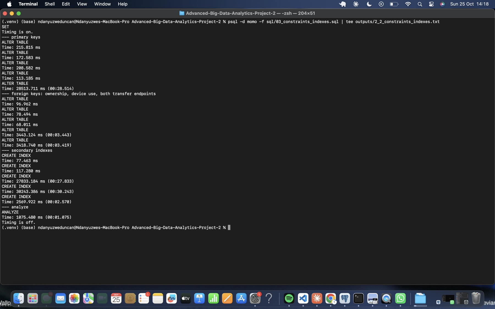{width=16cm}

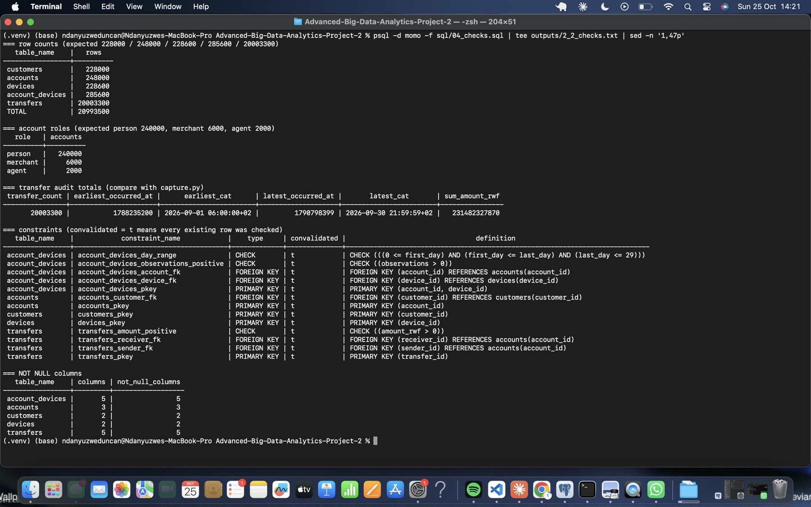{width=16cm}

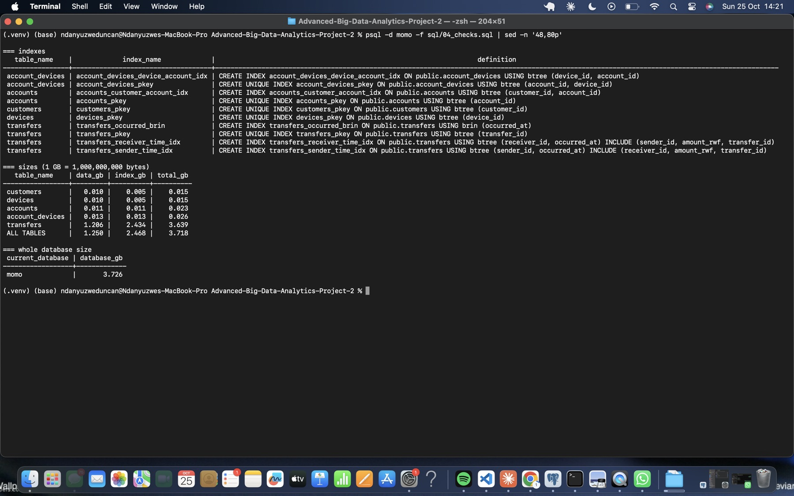{width=16cm}

# 3 Build Neo4j

## 3.1 Map the same facts

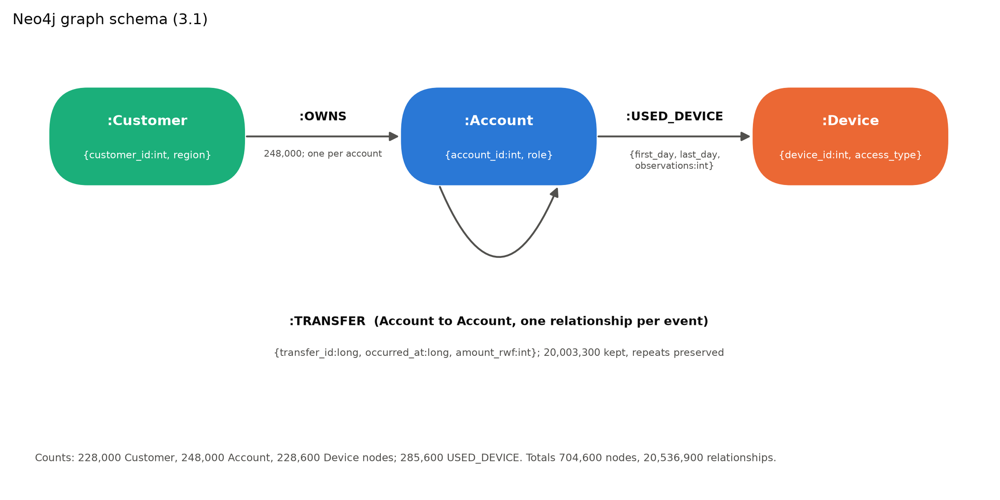{width=16cm}

| Source field | Graph element |
|---|---|
| customers.customer_id, region | `Customer.customer_id` (int), `Customer.region` |
| accounts.account_id, role | `Account.account_id` (int), `Account.role` |
| accounts.customer_id | `(:Customer)-[:OWNS]->(:Account)`. The column is `:IGNORE`d on the node and becomes this relationship. |
| devices.device_id, access_type | `Device.device_id` (int), `Device.access_type` |
| account_devices.account_id, device_id | `(:Account)-[:USED_DEVICE]->(:Device)` endpoints |
| account_devices.first_day, last_day, observations | `USED_DEVICE` properties (int) |
| transfers.sender_id, receiver_id | `(:Account)-[:TRANSFER]->(:Account)` start and end |
| transfers.transfer_id, occurred_at, amount_rwf | `TRANSFER` properties (long, long, int). Each event is a separate relationship. |

## 3.2 Prepare and import CSVs

`prepare_import.py` writes temporary copies to `import/` with typed headers, using separate `Customer`, `Account`
and `Device` ID groups. It replaces only the header line and streams the remaining rows, leaving the source CSVs
unchanged. It also derives `owns.csv` (`:START_ID(Customer),:END_ID(Account)`) from `accounts.csv`. The full
import was run with the database stopped:

```
neo4j-admin database import full neo4j --overwrite-destination --id-type=integer
  --nodes=Customer=import/customers.csv --nodes=Account=import/accounts.csv
  --nodes=Device=import/devices.csv --relationships=OWNS=import/owns.csv
  --relationships=USED_DEVICE=import/used_device.csv --relationships=TRANSFER=import/transfers.csv
```

| Step | Result |
|---|---|
| Import | **35.3 s** (40.3 s wall). 704,600 nodes, 20,536,900 relationships, 62,275,900 properties, peak memory 1.04 GiB, empty bad-row report |
| Constraints and index | 3 uniqueness constraints plus a range index on `TRANSFER.occurred_at`, all ONLINE 100%: **33.2 s** |
| Store / transaction logs | **2.064 GB** / 0.000016 GB (the offline import writes no transactions) |

Across three runs, the import took 35–70 s. In this run the importer warned that only 135 MiB of memory was
free. The slower runs most likely reflect memory pressure on an 8 GB machine with PostgreSQL also running.

**Checks.**

- Customer 228,000, Account 248,000 and Device 228,600 nodes (704,600 in total).
- OWNS 248,000, USED_DEVICE 285,600 and TRANSFER 20,003,300 relationships (20,536,900 in total).
- Roles match PostgreSQL. Every account has exactly one owner.
- There are 20,003,300 distinct transfer IDs.
- Audit totals are identical to capture.py and PostgreSQL.

The temporary import copies were then removed.

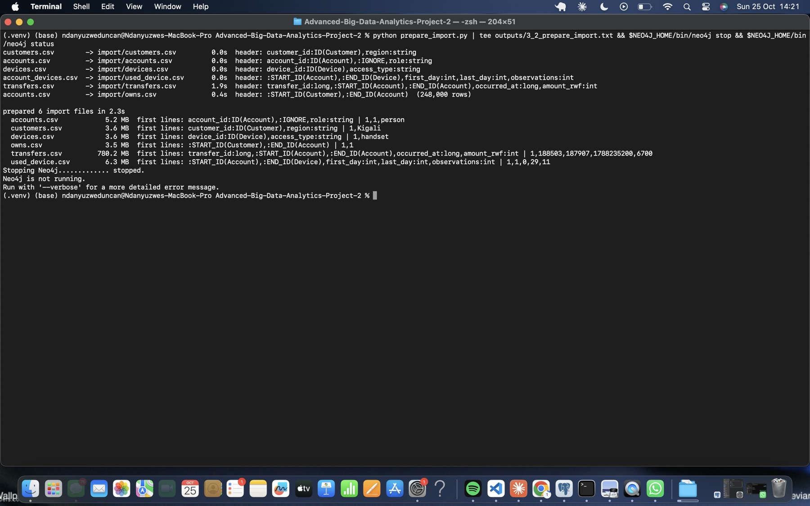{width=16cm}

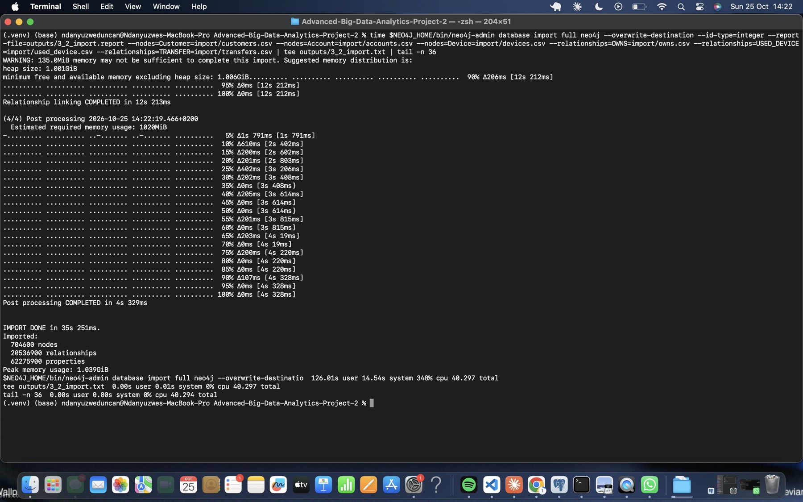{width=16cm}

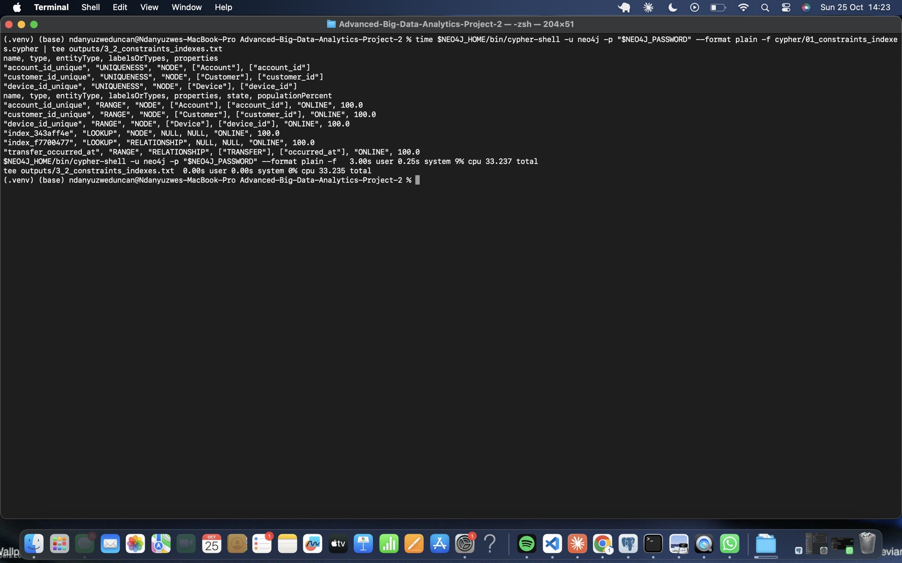{width=16cm}

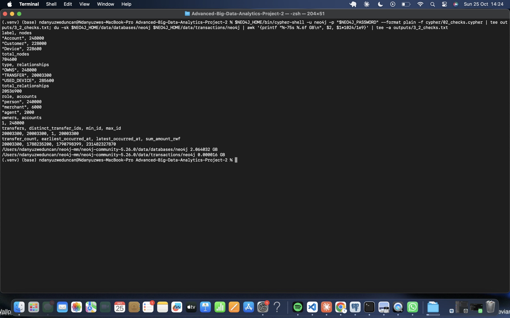{width=16cm}

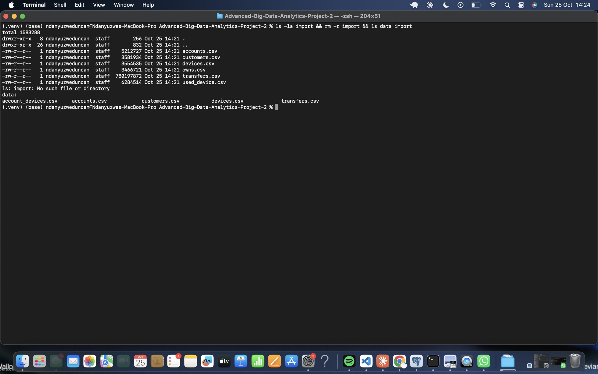{width=16cm}

## 3.3 Inspect one account in both models

Account 998 (set A) was traced to its owner, a device and an outgoing transfer with a SQL JOIN and a Cypher MATCH.
Both return the same row: owner 998 (Kigali), handset 998 (days 0–29, 39 observations), and transfer 113540 to
account 240004 at 2026-09-01 08:43:29 CAT for 2,100 RWF.

**How foreign keys become relationships.** Each FK column becomes a stored, directed relationship:

- `accounts.customer_id` becomes `OWNS`.
- The junction table `account_devices` becomes `USED_DEVICE`, and its non-key columns become relationship properties.
- `transfers.sender_id` and `receiver_id` become the start and end of a `TRANSFER` relationship, which carries the
  event columns.

SQL matches key values at query time through an index. Neo4j follows the stored link from the node.

**What collapsing repeated payments would lose.** The month has 20,003,300 transfers but only 8,103,289 distinct
sender→receiver pairs, so one edge per pair would erase 11,900,011 events. Account 998 alone repeats payments to
16 receivers; for example, it paid account 1111 nine times between 2 and 29 September (117,700 RWF in total).

A single edge would lose:

- each `transfer_id`
- each timestamp, and with it the order of events and the gaps between them
- each individual amount

Without those, the hour windows (Q1), daily totals (Q2), and time-ordered chains and cycles (Q5 and Q6) could no
longer be computed.

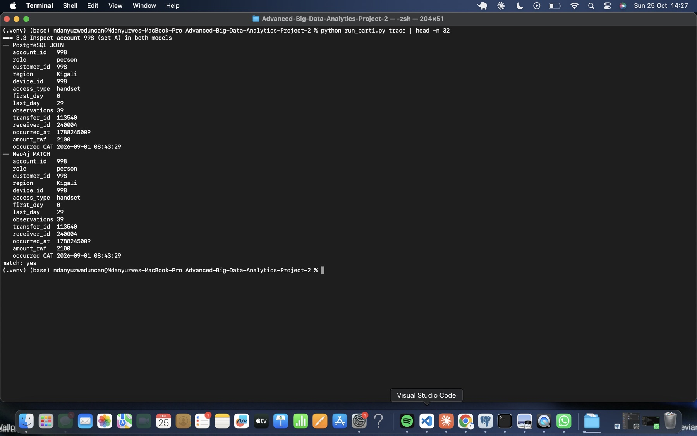{width=16cm}

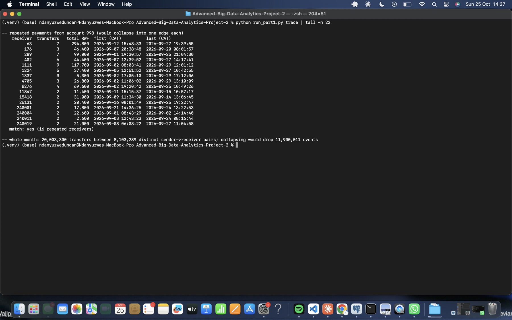{width=16cm}

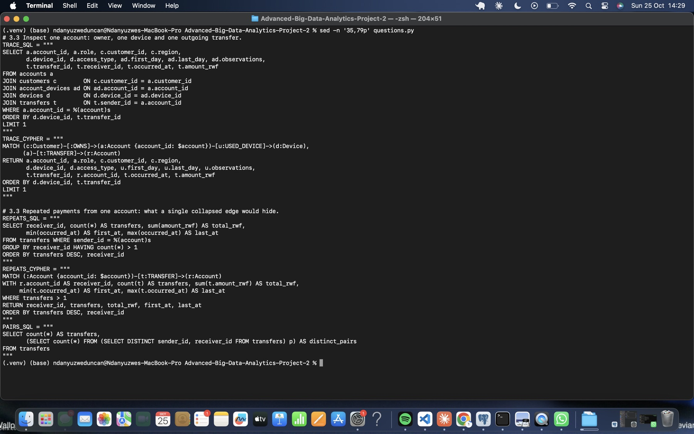{width=16cm}

# 4 Answer routine business questions

The review hour is 09:45:00 inclusive to 10:45:00 exclusive CAT. The boundaries are converted to epoch seconds
in Python with `zoneinfo('Africa/Kigali')`.

## 4.1 Q1 Account activity

| Set | Account | Date | Start epoch | End epoch | PG count / RWF | Neo4j count / RWF | Match |
|---|---:|---|---:|---:|---|---|---|
| A | 998 | 6 Sep | 1788680700 | 1788684300 | 1 / 200,000 | 1 / 200,000 | yes |
| B | 147228 | 13 Sep | 1789285500 | 1789289100 | 1 / 1,050,000 | 1 / 1,050,000 | yes |
| C | 206978 | 8 Sep | 1788853500 | 1788857100 | 1 / 300,000 | 1 / 300,000 | yes |
| D | 237998 | 6 Sep | 1788680700 | 1788684300 | 1 / 45,000 | 1 / 45,000 | yes |
| E | 144228 | 13 Sep | 1789285500 | 1789289100 | 1 / 40,000 | 1 / 40,000 | yes |
| F | 203978 | 8 Sep | 1788853500 | 1788857100 | 1 / 30,000 | 1 / 30,000 | yes |

**Why outgoing value is not a balance.** A balance is opening balance + money in − money out − fees ± reversals,
measured at a point in time. Q1 counts only outflows in one hour. It ignores incoming transfers, the opening
balance, and cash moved outside wallet-to-wallet transfers. The dataset is explicitly not a complete ledger: it
has no fees, reversals or cash balances.

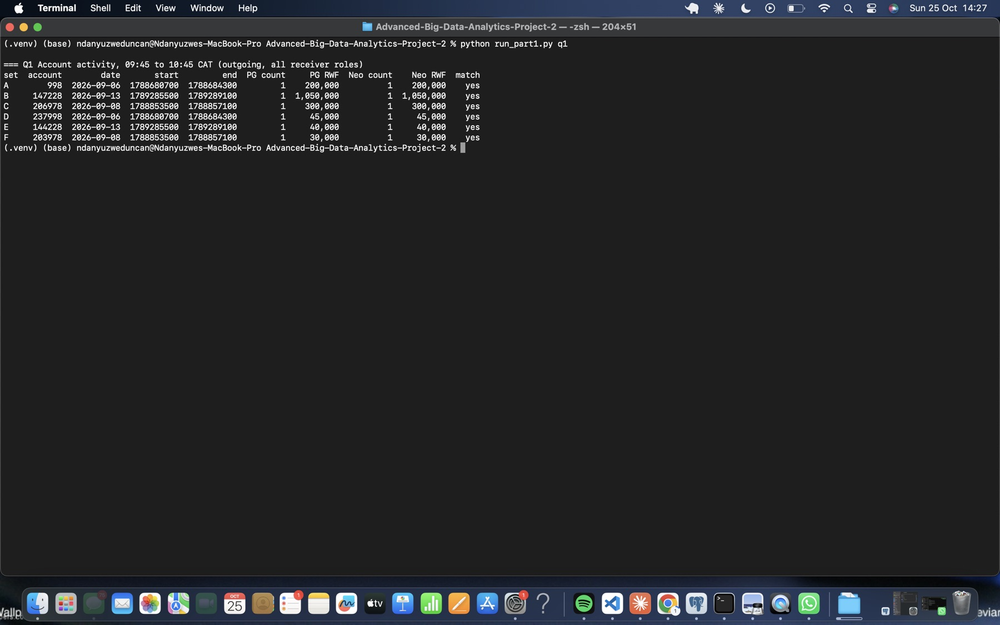{width=16cm}

{width=16cm}

## 4.2 Q2 Daily activity

Both engines return the same 30 CAT days, row for row. The daily sums reconcile exactly to the capture:
20,003,300 transfers and 231,482,327,870 RWF.

**Pattern.** Most days carry an almost constant 666,666–666,667 transfers worth about 7.67 billion RWF.

- **6–15 September:** 150–331 extra transfers per day (2,496 in total). Daily value is 50–190 million RWF above
  the baseline, so these extra transfers are few but large.
- **16–27 September:** a smaller excess of 30–121 transfers per day, with value back near the baseline, so these
  extra transfers are small.

The deviations are below 0.05% of the daily count and at most about 2.5% of the daily value. That's why the
chart's y-axes don't start at zero; the structure isn't visible in a zero-based chart. The bump coincides with
the review dates (6, 8 and 13 September).

**Why transfer value isn't provider revenue.** Revenue comes from fees and commissions, which aren't in the data.
Many transfers may carry low or zero fees. Agent commissions are a cost to the provider. The same money is
counted again each time it moves on. So 231 billion RWF is gross payment flow, not income.

As a single run (not a benchmark), PostgreSQL took 5.5 s and Neo4j 67.4 s. Formal timing follows in Section 6.2.

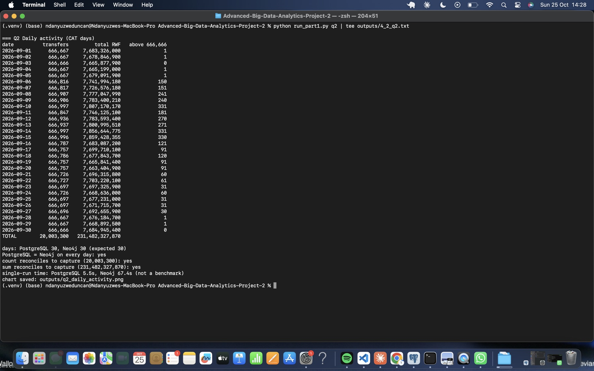{width=16cm}

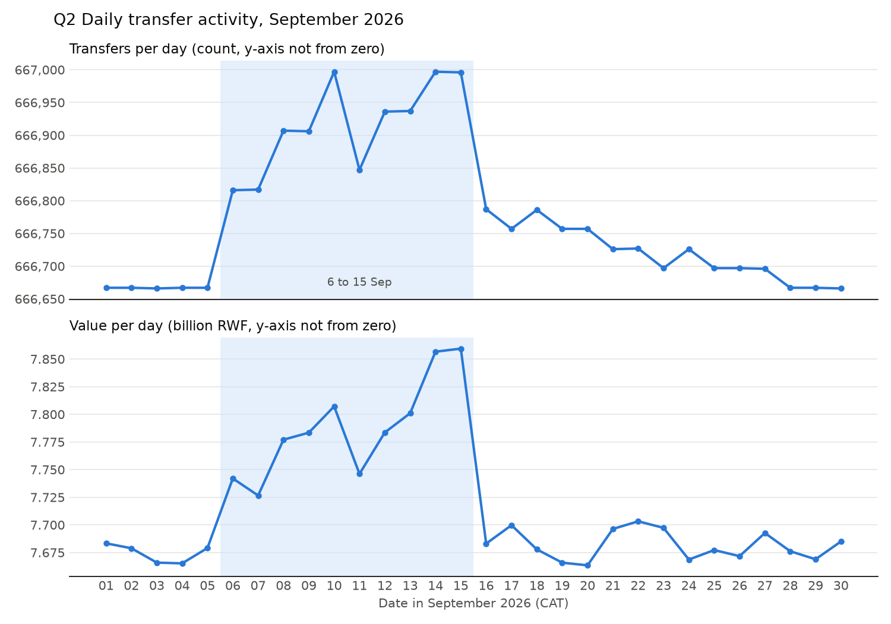{width=16cm}

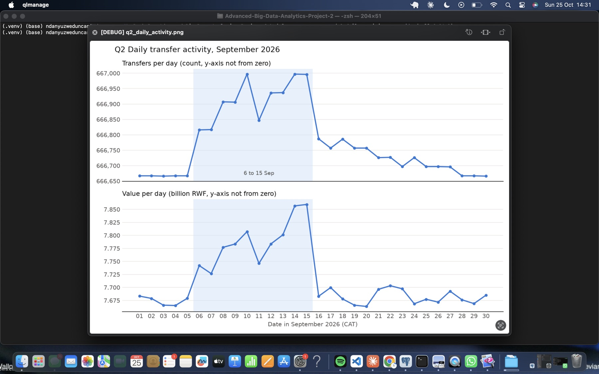{width=16cm}

## 4.3 Q3 Shared devices

The SQL self-joins `account_devices` on `device_id`. The Cypher matches
`(Account)-[:USED_DEVICE]->(Device)<-[:USED_DEVICE]-(Account)`. Both keep overlaps where
`max(first_day) <= min(last_day)` and exclude the review account.

| Set | Review account | Rows (PG / Neo4j) | Match |
|---|---:|---|---|
| A | 998 | 4 / 4 | yes |
| B | 147228 | 9 / 9 | yes |
| C | 206978 | 9 / 9 | yes |
| D | 237998 | 4 / 4 | yes |
| E | 144228 | 9 / 9 | yes |
| F | 203978 | 9 / 9 | yes |

Each review account's sharing falls into two groups:

1. **Its own phone, shared with close connections.**
   - Account 998 shares handset 998 with account 220998, owned by the **same customer**. Account 237998 likewise
     shares with 17998.
   - In sets B, C, E and F, four accounts with neighbouring IDs, owned by different customers in the **same
     region**, share one handset. This looks like a household phone. In C and F, one member's interval starts on
     day 11.
2. **A second handset (device IDs 228xxx).** It is shared with 3–5 accounts owned by **different customers,
   often in other provinces**. Each of these devices includes that set's **destination account**. This is a lead
   for Sections 5 and 8, not a conclusion. No public terminals appear.

**A legitimate sharing scenario.** Family members without their own phones use one household handset for their
separate wallets. Similarly, one person may keep a personal and a secondary wallet on the same phone.

**Why overlap does not prove simultaneous use.** Intervals are whole days, recording only the first and last day
of observation. `[2,7]` and `[5,11]` overlap on days 5 to 7, but the two accounts may have been observed on
different days within that range, or hours apart on the same day. The phone could also have been handed over or
resold in between. An observation shows that a wallet was seen on a device, not that it initiated a payment.

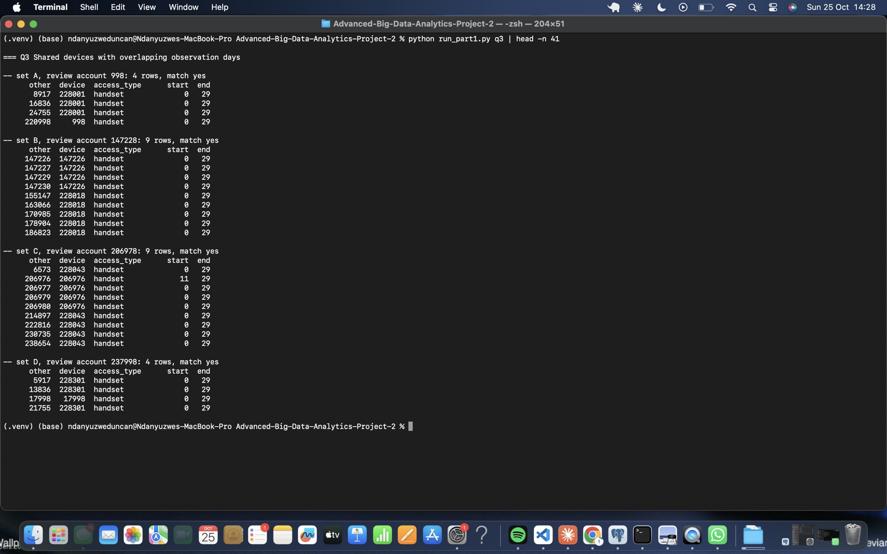{width=16cm}

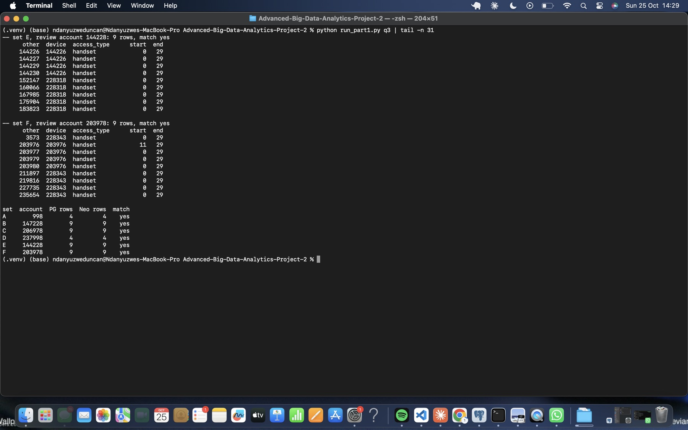{width=16cm}

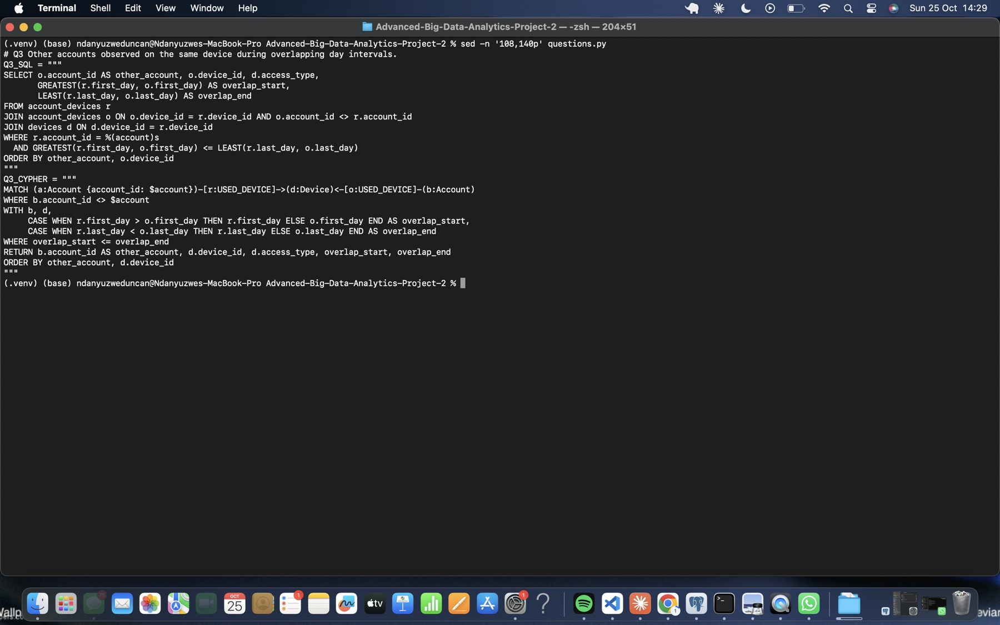{width=16cm}

# 5 Investigate connected accounts

## 5.1 Q4 Ownership and device network

The SQL builds an `edges` CTE from ownership and device-use rows in both directions. Each node carries a
kind, so Customer 7 and Account 7 stay distinct. The recursive `walk` follows those edges up to the depth
limit. The Cypher matches a bounded undirected path, `(a)-[:OWNS|USED_DEVICE*1..d]-(b:Account)`, and takes
`DISTINCT b` before grouping by the owner's region. Neo4j can then use a pruning breadth-first expansion
instead of enumerating every path. All **24 comparisons match**.

| Set | Depth 4 | Depth 6 | Depth 8 | Depth 10 |
|---|---:|---:|---:|---:|
| A (998) | 10 | 43 | 175 | 187 |
| B (147228) | 46 | 178 | 188 | 228 |
| C (206978) | 146 | 483 | 832 | 1,433 |
| D (237998) | 10 | 44 | 180 | 192 |
| E (144228) | 47 | 183 | 193 | 230 |
| F (203978) | 147 | 488 | 837 | 1,426 |

**Prediction.** We built the prediction from depths 4 and 6 only.

- **Method.** Every two links add one "account, then shared device" hop, so we treated the search as a
  breadth-first expansion with a constant branching factor. The growth ratio from depth 4 to 6 (r = n6 / n4)
  is applied again for depth 8 (n8 = n6 × r) and depth 10 (n10 = n8 × n8 / n6). That is a geometric
  extrapolation of the frontier.
- **Expectation.** A constant fan-out only holds while the frontier keeps meeting new devices. Once it has
  absorbed every device reachable from the review account's neighbourhood, growth should stall at the size
  of that connected component.

| Set | Predicted depth 8 | Actual depth 8 | Predicted depth 10 | Actual depth 10 |
|---|---:|---:|---:|---:|
| A | 185 | 175 | 796 | 187 |
| B | 689 | 188 | 2,667 | 228 |
| C | 1,598 | 832 | 5,287 | 1,433 |
| D | 194 | 180 | 855 | 192 |
| E | 713 | 193 | 2,778 | 230 |
| F | 1,620 | 837 | 5,378 | 1,426 |

The geometric model is close for A and D at depth 8, then overshoots everywhere at depth 10, by 3.7–12×. The
fan-out is not constant. A/D and B/E saturate at about 190–230 accounts, because their 228xxx handsets and
household phones lead to a small, closed neighbourhood: the frontier runs out of new devices. C/F keep
growing, more slowly than predicted, because a replacement handset and a shared household phone bridge into
further households, each adding a few accounts rather than multiplying them. The useful lesson is that reach
in this network depends on bridges, not on depth alone.

**How deeper links introduce weak associations.** The supporting path below reaches account 2984 from
set B's account 147228 in 10 links. It passes through five different devices and four intermediate accounts,
with no shared owner anywhere along the way. Each hop only means "seen on the same device at some time in
September". After several hops, the reached account has no meaningful relation to the review account. At
depth 10, sets C and F reach over 1,400 accounts spread evenly across all five regions. Most of these are
artefacts of shared phones, phone replacements and household handsets, not evidence about the account
under review.

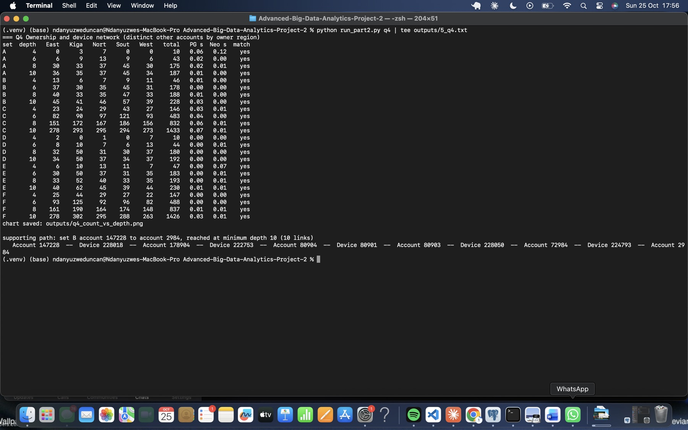{width=16cm}

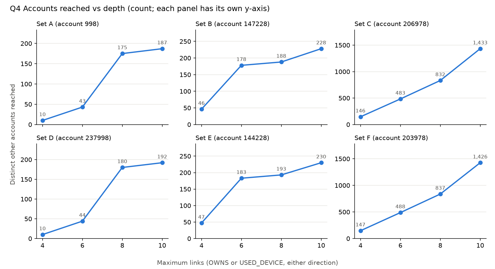{width=16cm}

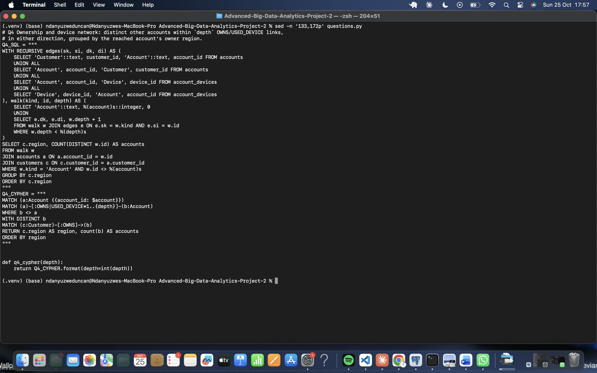{width=16cm}

## 5.2 Q5 Rapid onward payments

The query looks for three directed transfers through four distinct accounts:

- The first transfer leaves the review account within its hour.
- Each later transfer is at most 600 seconds after the previous one.
- Each amount satisfies `90*previous <= 100*next <= 105*previous`. In SQL, these are BIGINT comparisons.

SQL joins three transfer aliases on receiver equals next sender. Cypher matches three directed
relationships. All six sets match:

| Set | A | B | C | D | E | F |
|---|---|---|---|---|---|---|
| Chains | 1 | 1 | 1 | 0 | 0 | 0 |

**Example (set A).**

| Transfer | From → to | Time (CAT) | Amount (RWF) |
|---|---|---|---:|
| 20000001 | 998 → 8917 | 6 Sep 10:00:00 | 200,000 |
| 20000002 | 8917 → 16836 | 6 Sep 10:00:40 | 196,000 (98%) |
| 20000003 | 16836 → 24755 | 6 Sep 10:01:20 | 192,080 (98%) |

**Why this does not prove that the same funds moved.** Wallet balances are fungible, and the data has no
balances. Account 8917 may already have held 196,000 RWF, or received money from elsewhere, before paying
16836. Similar, steadily declining amounts are consistent with passing money on minus a fee, but they're
equally consistent with independent payments that happen to look alike. The records only show a sequence of
events, not which money was spent.

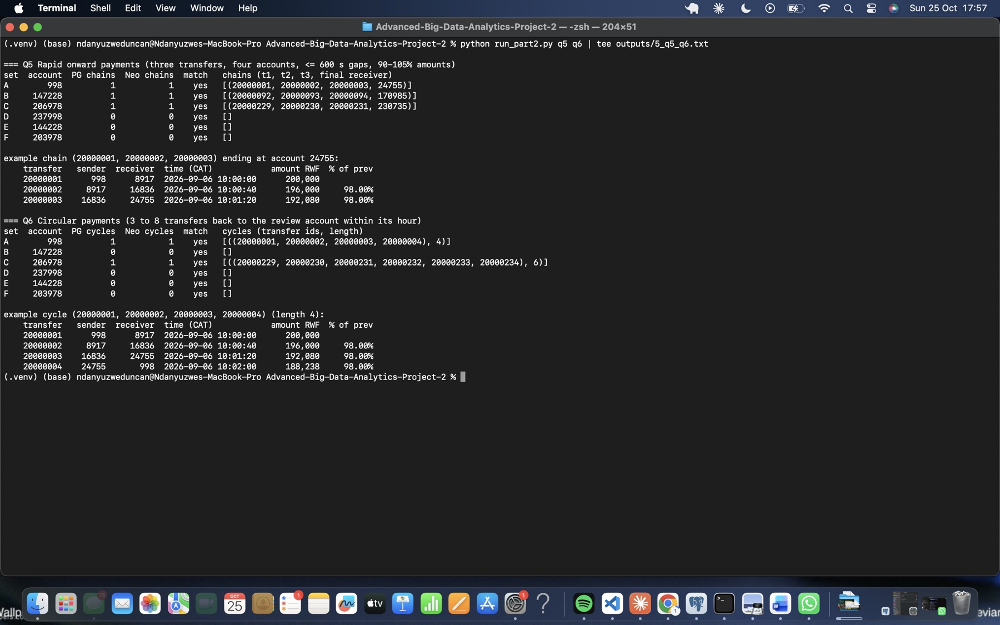{width=16cm}

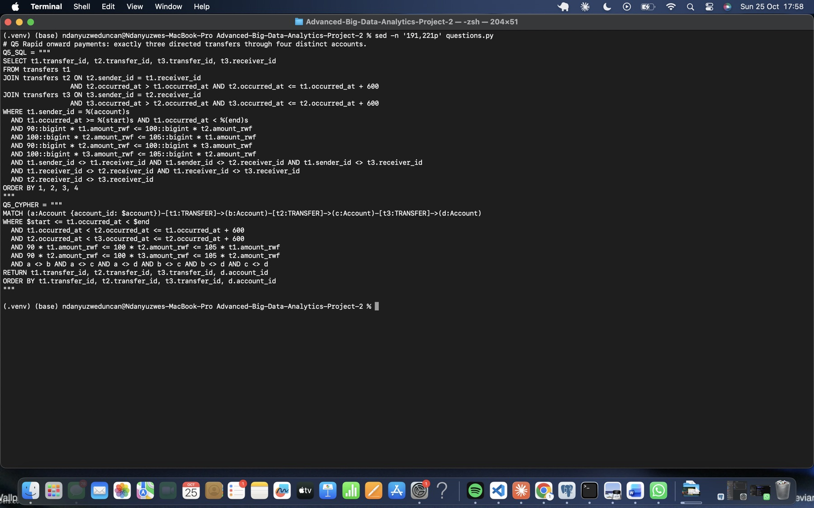{width=16cm}

## 5.3 Q6 Circular payments

The search looks for 3 to 8 transfers that start and end at the review account. Every transfer must fall
within the review hour, in strictly increasing time, with the whole sequence spanning at most 1,800 seconds,
and each amount must follow the Q5 rule. The search stops at the first return to the review account.

- **SQL:** a recursive CTE carries the current account, the transfer IDs so far, the first and last times
  and the last amount, and only extends with eligible transfers.
- **Cypher:** a bounded quantified path, `(a)((…)-[t:TRANSFER WHERE in hour]->(…)){3,8}(a)`, applies the
  same checks to the list of transfers.

All six sets match:

| Set | Cycles found |
|---|---|
| A | 1 cycle of 4 transfers: 998 → 8917 → 16836 → 24755 → 998, 10:00:00 to 10:02:00, 200,000 down to 188,238 RWF |
| C | 1 cycle of 6 transfers |
| B, D, E, F | none |

**Further evidence to request:**

- Which device and location initiated each payment.
- Wallet balances before and after each transfer.
- Know-your-customer (KYC) identity and any relationships between the owners.
- Cash-in and cash-out at agents around these times.
- Activity before and after September.
- Any customer complaints or reversals.

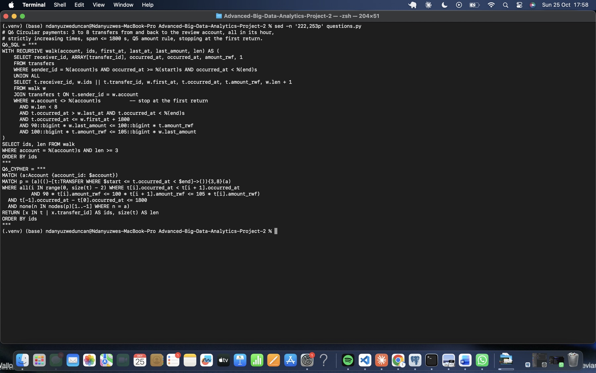{width=16cm}

## 5.4 Q7 Shortest transfer connection

Q7 finds the fewest directed transfers from each review account to its destination, using only person
accounts and ignoring amounts and time order. The bounds are 4 and 6. The person restriction is applied
*during* the search: in the SQL join to `accounts` at each step, and in the Neo4j `SHORTEST 1` quantified
path's inline `WHERE n.role = 'person'`.

| Set | Bound 4 | Bound 6 | Supporting path (bound 6) |
|---|---|---|---|
| A | 3 | 3 | 998 → 8917 → 16836 → 24755 |
| B | none | 5 | 147228 → 155147 → 163066 → 170985 → 178904 → 186823 |
| C | none | 5 | 206978 → 214897 → 222816 → 230735 → 238654 → 6573 |
| D | 3 | 3 | 237998 → 5917 → 13836 → 21755 |
| E | none | 5 | 144228 → 152147 → 160066 → 167985 → 175904 → 183823 |
| F | none | 5 | 203978 → 211897 → 219816 → 227735 → 235654 → 3573 |

All 12 lengths match. Each supporting path from Neo4j was checked in PostgreSQL: every transfer exists, the
transfers link in order, every account is a person, and the path length matches. Equally short paths may
exist.

Every route runs through exactly the accounts that share each set's 228xxx handset in Q3.

**Why no route within four transfers does not establish no connection.**

- The bound cuts the search off: sets B, C, E and F connect at length 5.
- The person-only rule excludes routes through merchants and agents.
- The data covers September only and excludes cash, bank and other channels.

**Why a structural route need not show onward movement of funds.** Q7 ignores time order and amounts. A
route can use a later transfer before an earlier one, or link unrelated payments of different sizes. It
shows that the accounts are connected, not that money flowed from one end to the other.

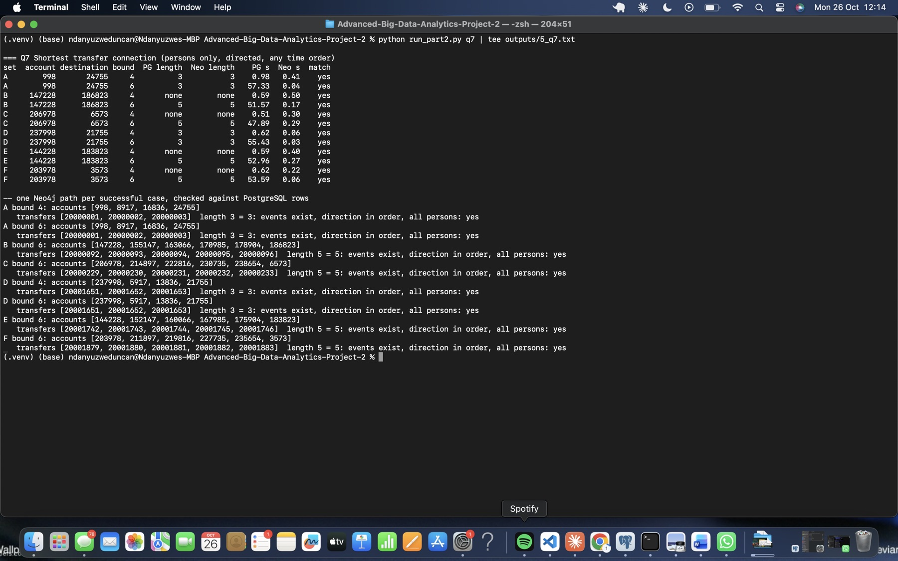{width=16cm}

{width=16cm}

# 6 Check correctness and performance

## 6.1 Build one comparison program

`compare.py` runs every case through `run_pg(query, params)` and `run_neo(query, params)`, using the wrappers
in `db.py`. These return every result row. Integers, decimals and dates are normalised to plain Python values
and the rows are sorted before an exact comparison.

**Result: 61 of 61 cases are identical.**

| Question | Q1 | Q2 | Q3 | Q4 | Q5 | Q6 | Q7 |
|---|---|---|---|---|---|---|---|
| Cases matching | 6/6 | 1/1 | 6/6 | 24/24 | 6/6 | 6/6 | 12/12 |

Q7 lengths were compared on their own. The 8 supporting paths were then validated separately: every
transfer exists, the transfers link in order, every account is a person, and the length matches.

**Independent checks in plain Python** against the captured CSVs, with no database involved:

- **Device overlap (set C).** `account_devices.csv` gives account 206978 the interval [0, 29] and account
  206976 the interval [11, 29] on device 206976. Their overlap is [11, 29], matching Q3.
- **Q5 chain and Q6 cycle (set A).** These were rebuilt from `transfers.csv`. Both are linked, strictly
  increasing in time, within 90–105% amounts, start in the review hour, and meet the 600 s (chain) or
  1,800 s (cycle) rule. Both are valid.

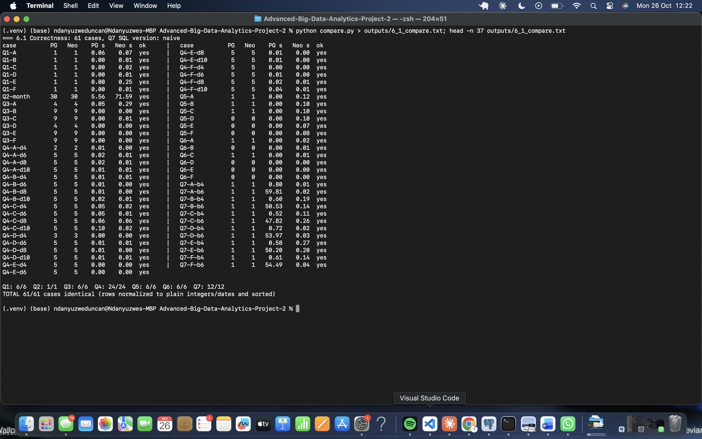{width=16cm}

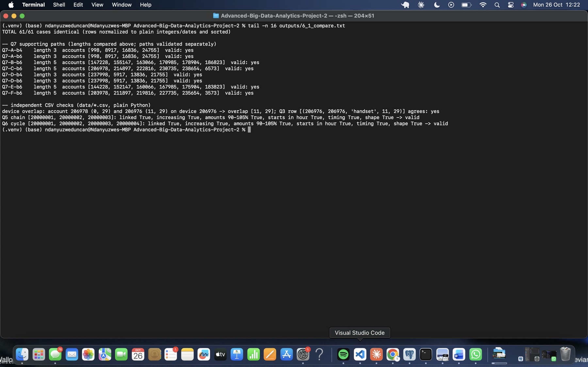{width=16cm}

## 6.2 Time a fixed selection

**Method.**

- Same machine, with one database service at a time: Neo4j was stopped while PostgreSQL was timed, and the
  other way round.
- Persistent connections and fixed settings (Section 1.1).
- 21 cases per engine, each with 3 untimed warm-ups (180 s limit) and 5 measured runs (60 s limit).
- `perf_counter` measures from submission until the final row is received. Answers are checked against 6.1
  outside the timer.
- Timeouts are recorded separately and never counted as completed timings.

The raw runs are in `outputs/6_2_runs_*.csv`, with case, parameters, engine, CAT start time, duration, row
count and status.

| Case | PG median ms | Neo4j median ms | PG/Neo4j |
|---|---:|---:|---:|
| Q1 B / E | 0.1 / 0.1 | 4.4 / 2.9 | 0.02 / 0.03 |
| Q2 month | 4,748 | 58,720 (2 of 5 runs timed out) | 0.08 |
| Q3 B / E | 0.5 / 0.2 | 4.0 / 2.6 | 0.12 / 0.08 |
| Q4 B depth 4 / 6 / 8 / 10 | 1.0 / 2.0 / 4.7 / 7.8 | 3.1 / 3.6 / 3.7 / 3.7 | 0.32 / 0.56 / 1.27 / 2.11 |
| Q4 E depth 4 / 6 / 8 / 10 | 0.5 / 2.1 / 4.8 / 7.9 | 2.1 / 2.9 / 2.5 / 2.6 | 0.24 / 0.72 / 1.92 / 3.04 |
| Q5 B / E | 0.7 / 0.3 | 6.1 / 4.3 | 0.11 / 0.07 |
| Q6 B / E | 0.5 / 0.1 | 3.4 / 1.5 | 0.15 / 0.07 |
| Q7 B bound 4 / 6 | 239 / 29,741 | 10.7 / 7.6 | 22 / 3,913 |
| Q7 E bound 4 / 6 | 247 / 28,926 | 5.7 / 7.4 | 43 / 3,909 |

PostgreSQL is faster for indexed look-ups (Q1, Q3, Q5, Q6) and for the full-month report (Q2). Neo4j is
faster once traversals deepen (Q4 at depths 8 and 10) and for shortest paths (Q7). Q2 on Neo4j takes about
59 s, close to the 60 s limit, and 2 of its 5 measured runs timed out.

**One processing difference: the Q2 plans.** PostgreSQL runs a **Parallel Seq Scan** over the 1.2 GB
`transfers` heap. Three workers each build a partial hash aggregate of 30 days, and a Gather Merge combines
them (6.6 s under EXPLAIN ANALYZE). Neo4j performs a **DirectedRelationshipTypeScan** over all 20,003,300
TRANSFER relationships with about 100 million dbHits. That's one store read per relationship plus its
`occurred_at` and `amount_rwf` properties, followed by building a `datetime` for each row, all in one
thread (68.8 s under PROFILE). The record store is built for following links, not for scanning and
aggregating a whole column.

For Q7, the reverse holds. Neo4j's `ShortestPath` operator answered with 26,600 dbHits. The naive SQL
recursion took 55 s; see 6.3.

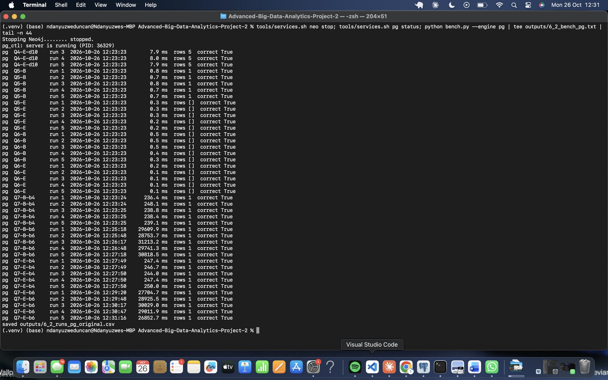{width=16cm}

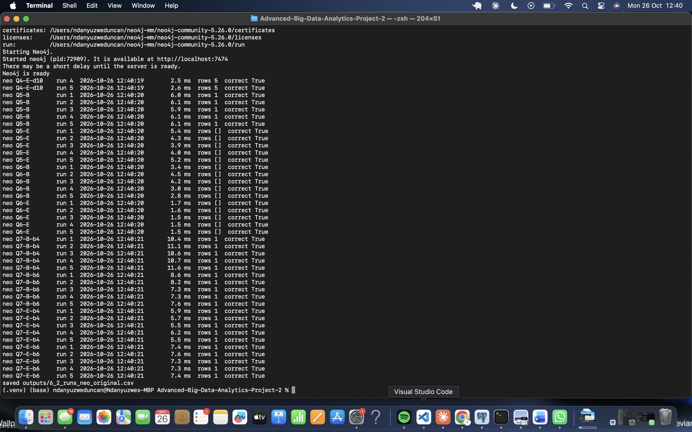{width=16cm}

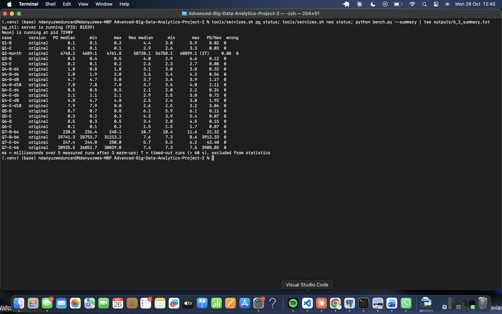{width=16cm}

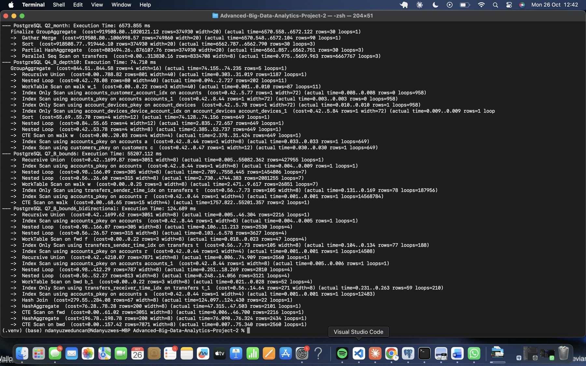{width=16cm}

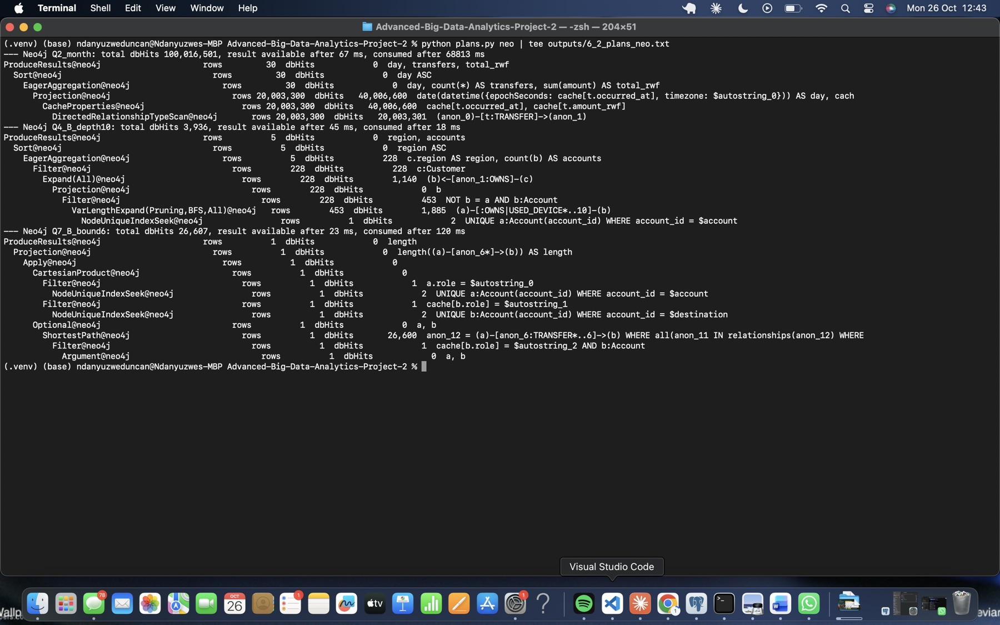{width=16cm}

## 6.3 Try one SQL improvement

**Wasted work in the Q7 plan.** The recursive CTE's `UNION` only removes duplicate *(account, depth)* rows,
so an account reached at depth 2 is expanded again at depths 3, 4, 5 and 6. For set B at bound 6:

- The recursion produced **427,955 working rows** over 7 iterations.
- It probed the sender index **187,956 times**.
- It looked up the receiving account's role **14.6 million times**.
- All of this took 55 s, only to find a single account at depth 5.

**Prediction and attempt.** We searched from both ends. The forward walk takes at most ceil(bound/2) steps
from the review account, and the backward walk at most floor(bound/2) steps from the destination along
incoming transfers. Each side keeps the minimum depth per account, and the shortest length is the minimum
of forward depth + backward depth over accounts where the two walks meet. Any route of length L ≤ bound
splits this way, so the result is exact.

The expected effect is roughly two orders of magnitude, because each side only explores about 3 levels
(about 2,000 to 3,000 rows each) instead of 6. No answers are hard-coded; the split is derived from the
bound.

**Outcome.**

- All 12 Q7 cases still match Neo4j.
- The plan now processes 2,216 forward and 2,560 backward rows (124.7 ms under EXPLAIN ANALYZE).
- The timed medians fell sharply:

| Case | Original | Improved | Speed-up |
|---|---:|---:|---:|
| B bound 4 | 239 ms | 3.8 ms | about 60× |
| E bound 4 | 247 ms | 3.5 ms | about 70× |
| B bound 6 | 29,741 ms | 38.2 ms | about 780× |
| E bound 6 | 28,926 ms | 39.0 ms | about 740× |

**The improved version is selected** for Section 7 and the final comparison. On the B/E bound-6 medians,
PostgreSQL takes 38.2 / 39.0 ms against Neo4j's 7.6 / 7.4 ms. The gap shrank from about 3,900× to about
5×. Most of the original gap came from the implementation, not from the data model.

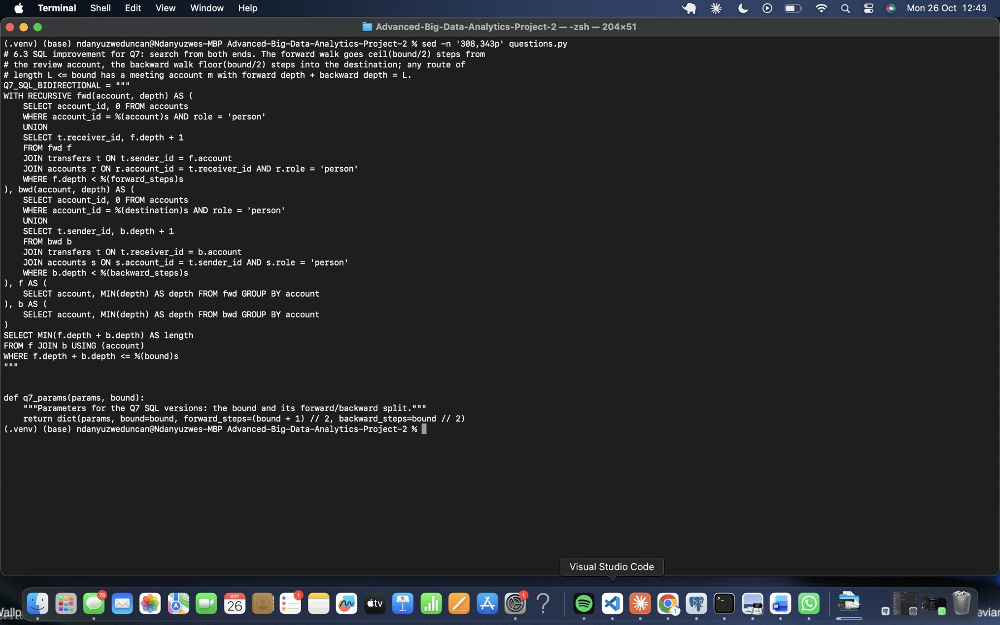{width=16cm}

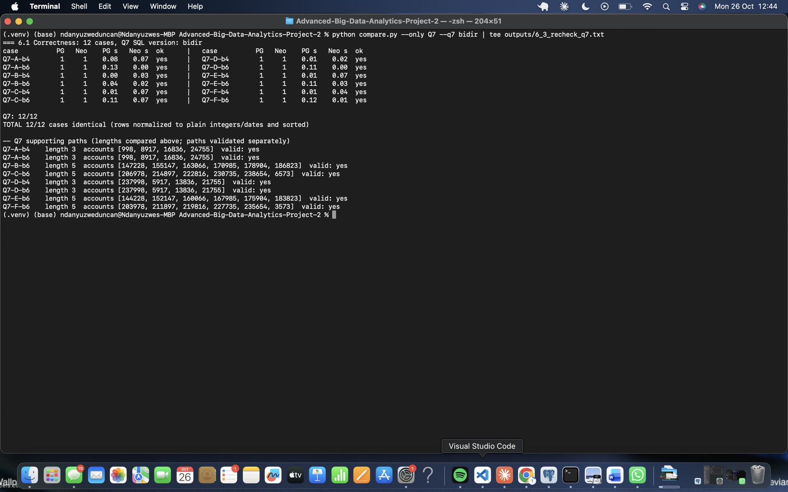{width=16cm}

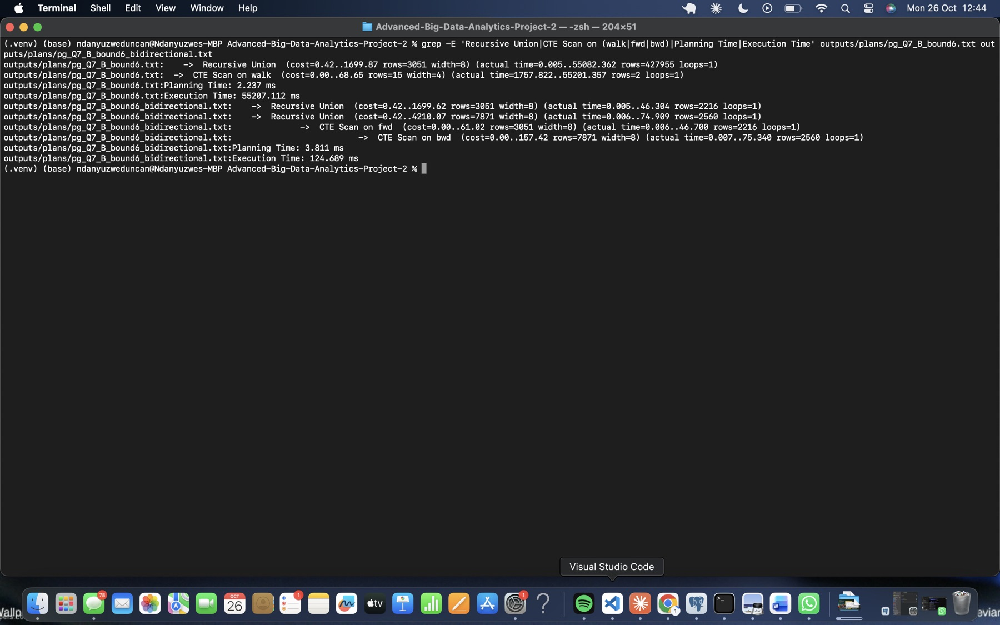{width=16cm}

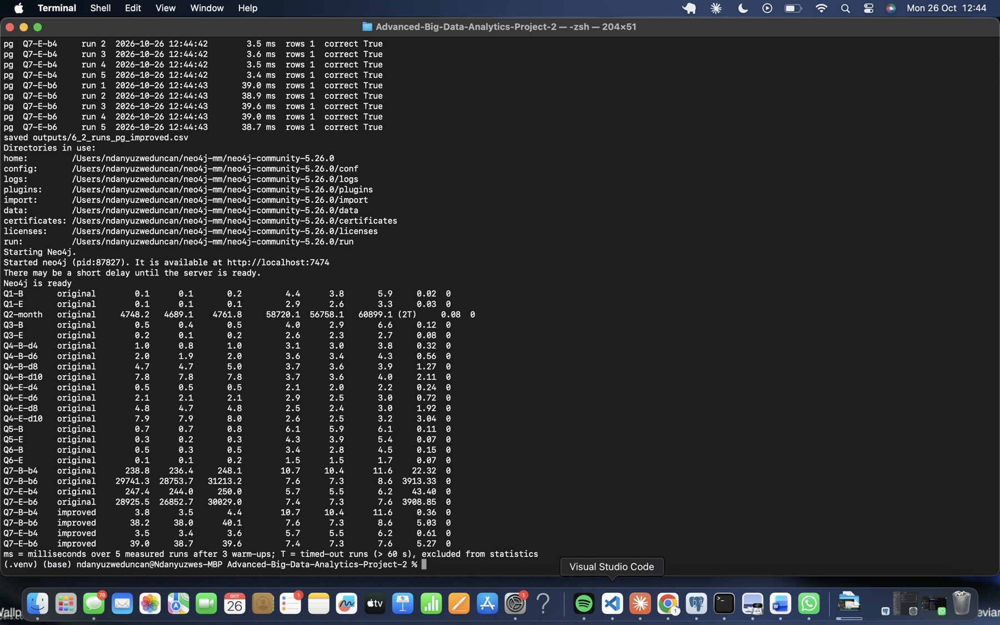{width=16cm}

# 7 Test concurrent requests

## 7.1 Build a small load test

**Method.** `loadtest.py` uses Python `multiprocessing`:

- One process per client, each with one persistent connection.
- Each client warms up once with sets A, B and C, then waits at a `Barrier`.
- The barrier's release fixes a common start time and a deadline 15 s later.
- Clients keep starting new A-B-C cycles until the deadline, finish any cycle already started, and send
  each request as soon as the previous one completes. The query timeout is 60 s.

**Workloads.** Q4 at depth 10, and Q7 length-only at bound 6 using the improved SQL. Each was run with 1, 4,
8 and 16 clients, 3 repetitions each, on each engine with the other service stopped. That's 48 runs. Every
request is logged in `outputs/7_requests.csv`, and correctness is checked after timing.

**Measures.** Throughput is correct completions divided by the time from barrier release to the end of the
last cycle. p95 is the sorted successful latency at position ceil(0.95n). Each row below is the median of 3
repetitions. Across all 48 runs there were **0 errors, 0 timeouts and 0 wrong answers**.

| Engine | Workload | 1 client req/s (p95 ms) | 4 clients | 8 clients | 16 clients |
|---|---|---|---|---|---|
| PostgreSQL | Q4 depth 10 | 69 (31) | 161 (60) | 202 (96) | 202 (197) |
| PostgreSQL | Q7 bound 6 | 26 (42) | 54 (92) | 61 (152) | 59 (341) |
| Neo4j | Q4 depth 10 | 402 (4.5) | 1,149 (7.3) | 1,446 (13.8) | 1,340 (36.2) |
| Neo4j | Q7 bound 6 | 245 (6.6) | 706 (11.4) | 825 (23.6) | 524 (71.8) |

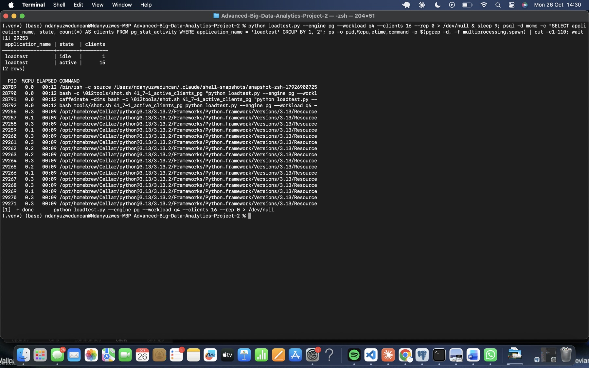{width=16cm}

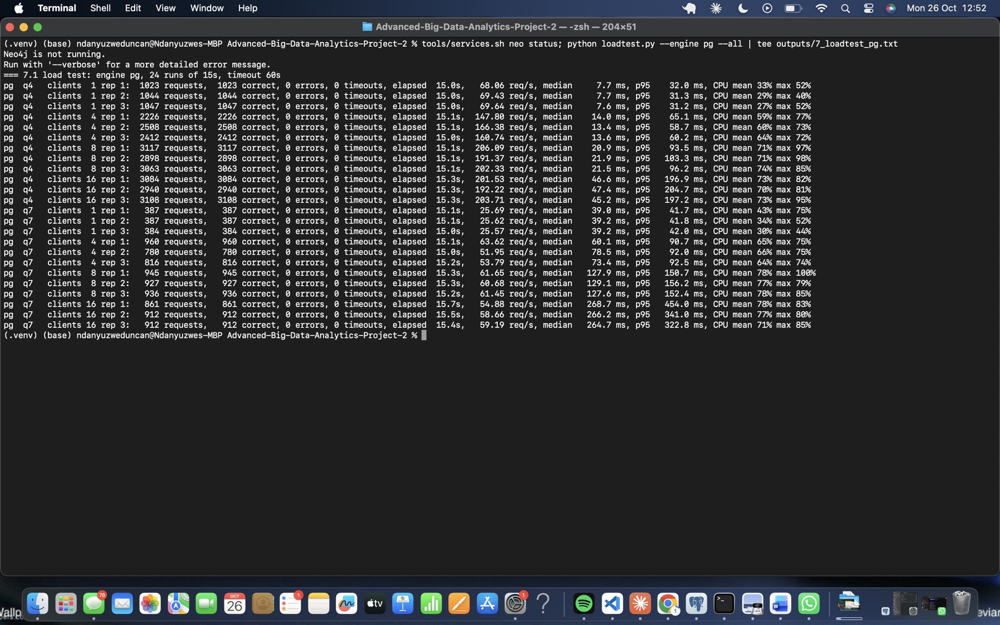{width=16cm}

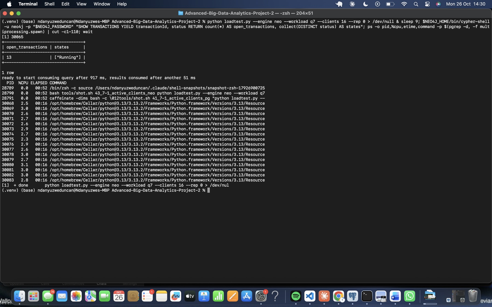{width=16cm}

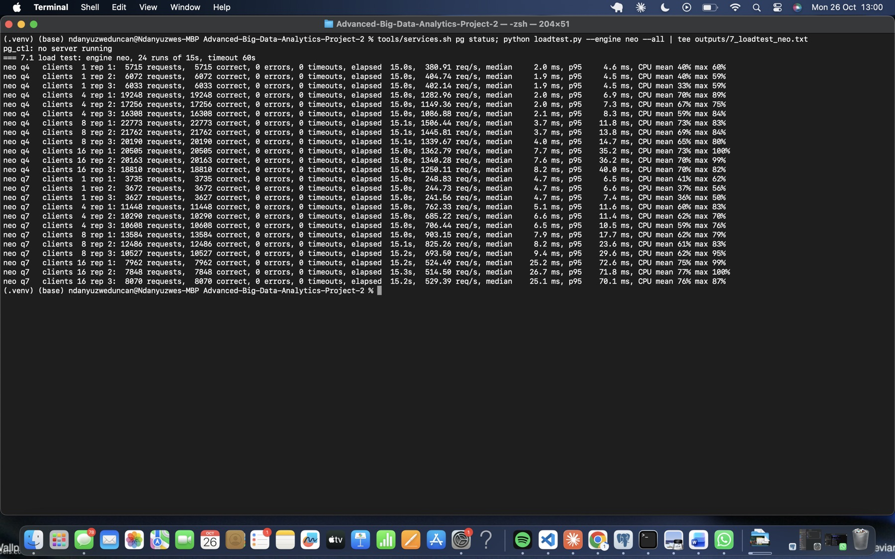{width=16cm}

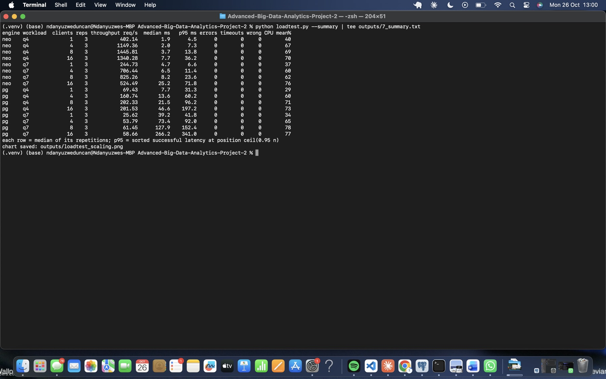{width=16cm}

## 7.2 Explain scaling

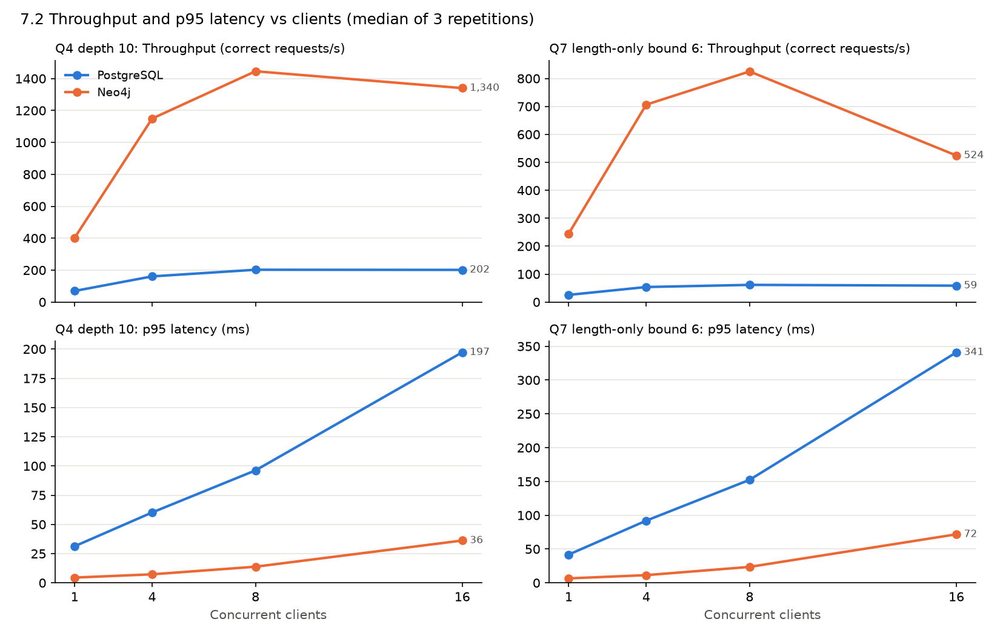{width=16cm}

**1 versus 16 clients.**

- Throughput rises 2.3–3.3× from 1 to 16 clients, but only up to about 8 clients.
- Beyond 8 clients it flattens (PostgreSQL Q4 202 → 202 req/s, PostgreSQL Q7 61 → 59 req/s) or falls
  (Neo4j Q7 825 → 524 req/s).
- p95 latency keeps growing throughout: PostgreSQL Q7 goes from 42 to 341 ms, and Neo4j Q7 from 6.6 to
  71.8 ms.

**Saturation.** The machine has 8 cores (4 performance and 4 efficiency). The 16 Python client processes run
on the same machine and compete with the database for those cores. Mean CPU rose from 29–40% at 1 client to
70–78% at 8–16 clients. Once there are more concurrent requests than cores can serve, extra clients just
queue: each request waits longer, so latency grows roughly in proportion while throughput stays flat. The
efficiency cores and client-side work limit how close CPU gets to 100%.

The plans explain why the engines saturate at different levels. A PostgreSQL Q7 request performs about 400
index probes plus hash aggregates and a hash join in its own backend process (about 38 ms each). A Neo4j
request is a ShortestPath search of about 26,600 dbHits served from the page cache by a worker thread
(about 5–7 ms).

**Throughput versus response time.** Throughput is the work completed by all clients per second; response
time is how long a single request waits. Between 8 and 16 clients, throughput barely changes, but every
analyst's request takes about 2–3 times longer.

**Does a graph advantage survive the SQL improvement?** In this experiment it does, but it is much smaller:

- With 1 client, Neo4j answers Q7 about 6× faster than the improved SQL.
- At 16 clients, Neo4j delivers about 9× the Q7 throughput with a p95 roughly 5× lower.
- For Q4 at depth 10, Neo4j's throughput is about 6–7× higher.

These claims are limited to this experiment: one 8 GB laptop, clients and database on the same machine,
September data, these two queries, and unequal memory settings (PostgreSQL shared_buffers 128 MB against
Neo4j's 2 GiB page cache). Before the SQL improvement, the Q7 gap was about 3,900×, which shows how much of
an apparent "graph advantage" can come from implementation choices.

# 8 Make and defend decisions

## 8.1 Prioritise investigation

Each pair has the same *structure*. In every set:

- the review account shares one handset (228xxx) with 3–5 accounts owned by other customers (Q3);
- the shortest person-only route to the destination runs through exactly those accounts (Q7);
- the ownership and device network reached at depth 10 is about the same size within each pair (Q4).

What separates the pairs is *tempo and value* (Q5, Q6).

| Pair | Evidence from Q3–Q7 | Review first |
|---|---|---|
| A / D | **A (998):** a Q5 chain and a Q6 cycle of 4 transfers, 998 → 8917 → 16836 → 24755 → 998. The transfers are 40 s apart, 200,000 → 188,238 RWF, each 98% of the previous one. Q7 length 3. Shares handset 228001 with all three route accounts.<br>**D (237998):** no chain and no cycle. Its length-3 route to 21755 runs 6 → 8 → 10 Sep, 2 days per hop, at a constant 45,000 RWF. It shares handset 228301 with the same route accounts. | **A** |
| B / E | **B (147228):** a Q5 chain of 1,050,000 → 1,029,000 → 1,008,420 RWF, 40 s per hop. The Q7 route continues for 5 transfers in under 3 minutes, leaving Eastern for Western. No cycle.<br>**E (144228):** a length-5 route at a constant 40,000 RWF, 13 → 21 Sep, 2 days per hop. No chain. | **B** |
| C / F | **C (206978):** a Q5 chain and a 6-transfer Q6 cycle through Southern → Eastern → Northern → Southern → Western → Southern. The cycle starts at 300,000 RWF, takes 4 minutes and returns 271,176 RWF. It has the widest Q4 network (1,433 accounts at depth 10).<br>**F (203978):** a length-5 route, 8 → 16 Sep, at a constant 30,000 RWF. F's Q4 network is just as wide (1,426), so the width is not distinctive. | **C** |

**Pair A/D in detail.** Both review accounts share a handset with the very accounts their money reaches:

- A shares device 228001 with 8917, 16836 and 24755.
- D shares device 228301 with 5917, 13836 and 21755.

All of these are observed on days 0–29, so device evidence alone cannot separate them.

The transfers can. On Sunday 6 September, A sent 200,000 RWF to 8917 at 10:00:00. 8917 passed on 196,000 RWF at 10:00:40, 16836 passed on 192,080 RWF at 10:01:20, and 24755 returned 188,238 RWF to A at 10:02:00. That is four hops in 120 seconds, each 98% of the previous amount, ending where it began.

D's three payments of exactly 45,000 RWF moved one hop every two days. That pattern is easier to read as ordinary repeated payments.

A's own second wallet, 220998, sits on A's handset 998 and is owned by the same customer. That link is unremarkable.

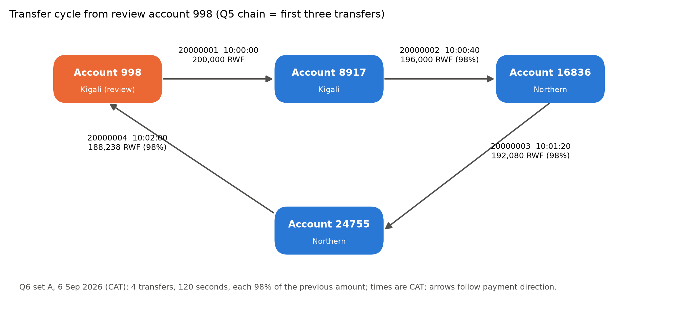{width=16cm}

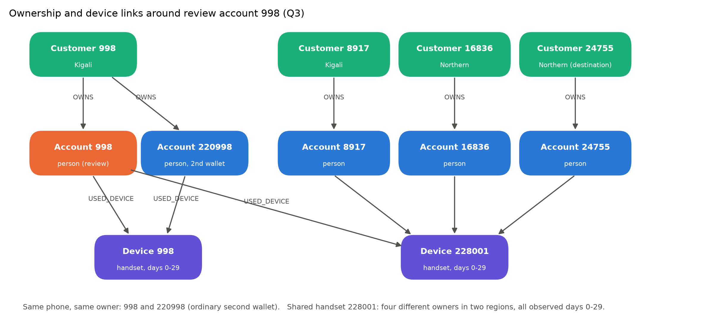{width=16cm}

**An ordinary explanation.** Four people who share one handset and pass money around quickly could be
running a rotating savings group (*ikimina*): one phone is used to make each member's contribution in turn.
A family might also move a sum through relatives' wallets to stay under per-wallet limits before paying a
shared expense. The 2% drop per hop could simply be transfer fees.

**Missing evidence and how it could change the judgement.** The records don't show:

- which device actually initiated each payment;
- wallet balances before and after each transfer;
- identity (KYC) links between the four owners;
- what happened to the money after it returned;
- any activity outside September.

If the owners turn out to be registered members of one savings group, or relatives, with the cycle repeating
monthly, priority should drop. If the balances show that the cycle inflated apparent turnover, or the money
was cashed out at an agent straight afterwards, priority should rise. **These records do not establish fraud.**

## 8.2 Recommend a model

**Reporting goes to PostgreSQL.** For the full-month daily report (Q2), PostgreSQL's parallel sequential scan
and hash aggregation take 4.7 s. Neo4j scans all 20 million TRANSFER relationships with about 100 million
dbHits in a single thread: 58.7 s, with 2 of 5 runs over 60 s. Single-account lookups (Q1, Q3, Q5, Q6)
also run 7–50× faster in PostgreSQL through covering indexes.

**Traversal investigations go to Neo4j.** For Q7 at bound 6, the Cypher `SHORTEST 1` path with an inline
person filter is planned as a single ShortestPath operator (26,600 dbHits, 7.6 ms). The recursive SQL
re-expanded every account at every depth: 427,955 working rows and 14.6 million role lookups, taking
29.7 s. For Q4 at depth 10, Neo4j's pruning breadth-first expansion takes 3.7 ms against PostgreSQL's
7.8 ms. Under concurrency, Neo4j sustained 1,340 Q4 and 524 Q7 requests/s at 16 clients against
PostgreSQL's 202 and 59, with p95 latency 5× lower.

**Load time and storage.** PostgreSQL took 19.6 s to load and 98 s to build keys and indexes, using 3.73 GB.
Neo4j took 35 s to import offline and 33 s to build constraints, using 2.06 GB. However, the Neo4j import
required preparing CSVs and stopping the database.

**Evidence against preferring Neo4j.** Rewriting Q7 in SQL to search from both ends cut it to 38 ms. That
narrowed a 3,900× gap to 5×, so most of the original gap was the algorithm, not the data model. PostgreSQL
also wins every reporting and point-lookup case. Running both systems doubles operations work.

**Modelling benefit versus implementation effect.** The graph model's benefit is that relationships are
stored as links and patterns are short to write. The quantified path for Q6 is 8 lines; the recursive CTE
is 18. The speed of Q7, by contrast, comes mostly from Neo4j's built-in bidirectional search, which SQL can
partly reproduce.

**Freshness.** If transfers are copied into Neo4j, the copy should be no more than 5 minutes behind, fed
from change data capture. Q5 chains span 10 minutes, so a stale copy would miss chains still in progress.
Analysts could wrongly report "no route", or prioritise using yesterday's network. Q4 and Q7 answers from
an out-of-date graph could also contradict the PostgreSQL reports.

**Limits.**

1. One 8 GB laptop, with clients on the same machine and unequal memory settings (shared_buffers 128 MB
   against a 2 GiB page cache).
2. One month of generated data, six review sets and read-only queries. Write load and update cost were not
   tested.

## 8.3 Explain individual judgement

**Ndanyuzwe Duncan (101413): loading cost is mostly index cost.** PostgreSQL loaded all 20,003,300
transfers with `\copy` in 19.0 seconds. Building the primary keys, foreign keys and secondary indexes
afterwards took 98 seconds, five times the load itself. The two covering indexes on `transfers` alone took
58 seconds, and the table's indexes occupy 2.43 GB against 1.21 GB of table data. That happens because each `INCLUDE`
column is copied into the index, so the index-only scans that make Q1 and Q5 fast are paid for at load time
and in storage. Neo4j's offline import wrote 704,600 nodes and 20,536,900 relationships in about 35 seconds
plus 33 seconds for constraints, in 2.06 GB, because adjacency is written once into the record store. One
check could overturn this: the Neo4j import ranged from 35 to 70 seconds across three runs when free memory
was low. The comparison should be repeated on a machine with nothing else running, and with the PostgreSQL
indexes created before loading, before claiming either engine loads faster.

**Byiringiro Eric (101389): deeper network links mostly measure shared phones.** In Q4, account 998 reaches
187 other accounts within ten ownership and device links, while account 206978 reaches 1,433, spread evenly
over all five regions. The supporting path for set B crosses five devices and four unrelated accounts before
reaching account 2984, with no shared owner anywhere along it. The width comes from bridges: a replacement
handset or a household phone joins one neighbourhood to the next, so each extra pair of links adds whole
households. That is why our geometric prediction failed at depth 10. Beyond about four links, the count
says more about how phones are shared in this dataset than about the account under review. A check that could
overturn this: rerun Q4 counting only devices with overlapping observation days, and excluding devices
seen with more than five accounts. If sets C and F still reach over a thousand accounts, the wide network is
a real property of those accounts rather than an artefact of shared handsets.

**Mfuranzima Sandrine (101411): Neo4j's Q7 advantage was mostly an algorithm advantage.** Our first
recursive SQL took 29.7 seconds for the shortest route at bound 6, against 7.6 milliseconds in Neo4j, a
ratio of about 3,900. The plan showed why: `UNION` only removes duplicate account-and-depth pairs, so the
same accounts were expanded again at every depth. That meant 427,955 working rows and 14.6 million role
lookups to find a single account at depth 5. Rewriting the query to search three steps forward from the
review account and three steps backward from the destination, joining where the two walks meet, cut it to
38 milliseconds. All twelve answers stayed the same. The remaining gap is only about five times, and under
16 concurrent clients Neo4j still delivered about nine times the throughput. A check that could overturn
the remaining gap: PostgreSQL ran with 128 MB of shared buffers while Neo4j had a 2 GiB page cache.
Retiming with equal memory could shrink the difference further.

**Contributions.** The work was divided by the pages of the brief.

| Member | Brief pages | Work |
|---|---|---|
| **Ndanyuzwe Duncan** | 1–3 | Sections 1–3: workspace and environment set-up, `capture.py`, PostgreSQL tables, constraints, bulk load and checks, the Neo4j import and checks, and the 3.3 inspection of one account in both models. |
| **Byiringiro Eric** | 4–6 | Sections 4–5: the Q1 to Q7 SQL/Cypher query pairs, the Q2 and Q4 charts, and the investigation evidence (shared devices, the ownership network, rapid onward payments, cycles and shortest routes). |
| **Mfuranzima Sandrine** | 7–9 | Sections 6–9: the 61-case comparison program, timing and plans, the Q7 SQL improvement, the concurrent load test, the investigation priorities and model recommendation, and the submission. |

All three members reviewed the full report.

**LLM and external assistance.** Claude (Anthropic) assisted with environment setup, code, running the
experiments and screenshots, and drafting the report, including first drafts of the individual notes,
which each member reviewed. Every result was verified as described below.

**How the work was checked:**

- every answer was compared between two independent engines (61/61 identical);
- one device overlap, one chain and one cycle were re-checked directly from the CSV files in plain Python;
- row counts and audit totals were reconciled across capture.py, PostgreSQL and Neo4j;
- timings come from saved raw runs (`outputs/6_2_runs_*.csv`, `outputs/7_runs.csv`).

All results in this report come from real runs on the machine described in Section 1.1. Each member can
explain the work in their own sections.

# 9 Submit reproducible work

## 9.1 Prepare the report

This PDF follows milestone order. It contains the models, summaries, charts and embedded evidence, with
explanations kept brief. Complete outputs, raw repetitions and plans are in `outputs/` in the code
submission.

## 9.2 Provide code and verification

**Code.** GitHub: <https://github.com/Duncanwar/Advanced-Big-Data-Analytics-Project-2>, with a matching ZIP.

The repository contains:

- the unchanged generator;
- the capture and import programs;
- the SQL and Cypher definitions;
- the queries, checks, benchmarks and load test;
- raw results and plans;
- a README listing the commands in execution order.

Secrets are placeholders (`.env.example`). The CSVs and database stores stay local. The generator's SHA-256
matches the value recorded in Section 1.1 (`2ea0e59d…e9455a`).

The submitted 61-case comparison was re-run, and both database services were then stopped. Their stores
are retained.

{width=16cm}

{width=16cm}
